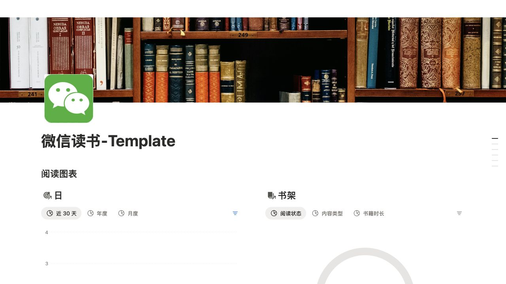

# WeRead2Notion AI

[简体中文](README.md) · [English](README.en.md) · [日本語](README.ja.md) · [WeRead2Notion AI ↗](https://hodgekou.github.io/weread2notion-AI/)

Sync your WeRead (微信读书) bookshelf to Notion. GitHub Actions updates the template daily with your books, reading time, progress and chapter notes. The project is free to use under the MIT license.



## What gets synced

The current WeRead shelf (`/shelf/sync`) determines which books to import. Each book page groups your highlights and thoughts by chapter. Authors, categories and daily, weekly, monthly and annual statistics feed the template’s native Notion views and charts. A daily snapshot per book records total time, time added that day, progress, reading status and current chapter.

## Set up your first sync

1. Open the [Notion template](https://app.notion.com/p/wph/Template-3a329affe5af800b8581f98b71e948fb), select **Duplicate** and copy the URL of the new top-level page in your workspace.
2. Create an internal integration in [Notion Integrations](https://www.notion.so/profile/integrations) in the same workspace. Enable **Read content**, **Insert content** and **Update content**. Copy the internal integration secret. On the duplicated top-level page, open **••• → Connections** and add the integration so it can discover all nested databases.
3. Fork this repository. In your fork, open **Settings → Secrets and variables → Actions → New repository secret** and add the three repository secrets below.
4. In your fork, open **Actions → weread sync → Run workflow**. Leave `full` unchecked for the first run. When the **Sync** job finishes, check its **Summary** for counts and refresh Notion.
5. The workflow runs daily at **20:00 UTC** (04:00 the following day in Beijing). To change the schedule, edit the cron expression in [.github/workflows/weread.yml](.github/workflows/weread.yml) on your fork’s default branch.

| Secret | Value |
| --- | --- |
| `WEREAD_API_KEY` | Gateway API key from the [WeRead assistant](https://weread.qq.com/r/weread-skills) |
| `NOTION_TOKEN` | Internal secret of the integration connected to your copy |
| `NOTION_PAGE` | Full URL of your copy, or its page name followed by its 32-character page ID |

## How updates affect your workspace

With the default settings, removing a book from WeRead moves its synced Notion page and notes to the trash on the next successful sync. Historical snapshots remain available. The sync updates managed properties, statistics, generated book content and system settings. You can customize the homepage layout, views, filters, sorting and charts. Keep your own writing outside generated sections.

A book counts as finished when you mark it as read in WeRead (`finishReading=1`). Books with reading activity otherwise remain in progress. Use `full` when you need to back up and rebuild database rows. The workflow uploads the resulting JSON backup as an artifact. If a book detail request encounters a retryable error such as HTTP 499, the sync preserves that book’s existing data, processes the others and lists failures in the summary for the next run.

## Template settings

The sync reads **同步设置** in the **设置** database before each run and creates it with defaults if missing. Match the Chinese property names in your copy.

| Property | Notion type and default | Effect |
| --- | --- | --- |
| 阅读完成进度强制改为100% | Checkbox, off | Display finished books at 100% in Notion |
| 只同步我的书架书籍 | Checkbox, on | Trash synced content for books removed from the shelf |
| 同步划线和笔记 | Checkbox, on | Write highlights and thoughts to book pages |
| 保存阅读快照 | Checkbox, on | Save one snapshot per book per day |
| 阅读统计起始年份 | Number, 2023 | First year included in reading statistics |

Use native Checkbox and Number properties. Leave the system field `同步配置版本（不可删除）` intact. Your saved settings persist across runs.

## Run locally

From a checkout, install with Python 3.10 or newer. Fill in the three credentials above in your private `.env` file.

```sh
cp .env.example .env
python -m venv .venv
source .venv/bin/activate
pip install -e .
```

Optional environment variables include `START_YEAR` (default `2023`), `BACKUP_DIR` (default `backups`), `NOTION_VERSION` and `NOTION_REQUEST_INTERVAL`.

```sh
weread2notion check                     # Inspect template databases and properties
weread2notion sync --dry-run            # Preview the plan using WeRead data only
weread2notion sync                      # Incremental sync
weread2notion sync --full               # Back up and rebuild database rows
weread2notion export --format json --output weread-export
weread2notion export --format markdown --output weread-export
```

Export reads WeRead directly and writes a private local copy with a `manifest.json`. Markdown export adds descriptions, highlights and notes under `books/`.

## Troubleshooting

- **Could not find block with ID** — Check that the page URL points to your duplicate, the token belongs to the connected integration and both are in the same workspace.
- **Empty 全部 view or missing year** — Check the latest run and template. Year grouping uses completion or reading dates. Remove empty year filters.
- **Scheduled run missing** — Enable Actions on your fork and check the workflow on its default branch. Scheduled runs can be delayed.
- **Reading time shows 还未阅读** — Run an incremental sync again to refresh the cumulative time from WeRead.
- **Update a fork** — Read the release notes, choose **Sync fork** and merge upstream changes into your main branch before running the updated workflow.

Report expected behavior, reproduction steps, redacted logs, book ID and sync mode in [GitHub Issues](https://github.com/hodgekou/weread2notion-AI/issues/new/choose). Keep keys, cookies, tokens, private notes and `.env` out of reports and commits.

[Technical documentation (Chinese)](docs/TECHNICAL.md) · [v1.0.0 release notes (Chinese)](docs/RELEASE_NOTES_v1.0.0.md)

The project’s code, documentation and Notion template adaptations were generated by OpenAI ChatGPT (Codex, GPT-5 series). [MIT license](LICENSE)
