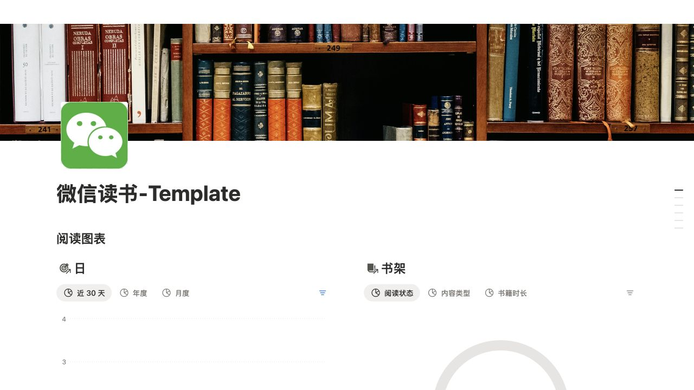

# WeRead2Notion AI

[简体中文](README.md) · [English](README.en.md) · [日本語](README.ja.md) · [プロジェクトサイト](https://hodgekou.github.io/weread2notion-AI/)

微信読書（WeRead）の本棚を Notion に同期するオープンソースのツールです。GitHub Actions が毎日、蔵書、読書時間、進捗、章ごとのハイライトや感想を更新します。

## 同期するデータ

微信読書の現在の本棚（`/shelf/sync`）から書籍を取り込みます。ハイライトと感想は各書籍ページに章ごとにまとまります。著者やカテゴリ別に本を探したり、日・週・月・年単位の読書統計を Notion のグラフで確認したりできます。書籍ごとの日次記録には累計読書時間、その日の増加分、進捗、読書状態、現在の章が含まれます。

## 初回の設定

1. [Notion テンプレート](https://app.notion.com/p/wph/Template-3a329affe5af800b8581f98b71e948fb)を **Duplicate（複製）** し、自分のワークスペースにできた最上位ページの URL を控えます。
2. 同じワークスペースで [Notion インテグレーション](https://www.notion.so/profile/integrations)を作成します。**Read content**、**Insert content**、**Update content** を有効にして内部インテグレーションのシークレットをコピーします。複製した最上位ページの **••• → Connections** から接続すると、配下のデータベースにアクセスできます。
3. このリポジトリを **Fork** します。自分のフォークの **Settings → Secrets and variables → Actions → New repository secret** で、下表の3件を登録します。
4. 自分のフォークで **Actions → weread sync → Run workflow** を開きます。初回は `full` のチェックを外して実行します。**Sync** ジョブが完了したら **Summary** の件数を確認し、Notion を再読み込みします。
5. 自動実行は毎日 **日本時間 05:00**（UTC 20:00、北京時間 04:00）です。時刻を変更するにはフォークの既定ブランチで [weread.yml](.github/workflows/weread.yml) の cron 式を編集します。

| シークレット名 | 値 |
| --- | --- |
| `WEREAD_API_KEY` | [微信読書アシスタント](https://weread.qq.com/r/weread-skills)から取得した Gateway API キー |
| `NOTION_TOKEN` | 複製先に接続したインテグレーションのシークレット |
| `NOTION_PAGE` | 複製先ページの完全な URL、またはページ名の末尾に32文字のページ ID を付けたもの |

## 詳しい情報

- [利用ガイド](https://hodgekou.github.io/weread2notion-AI/guide.ja.html)：データの更新と削除、Notion で変更できる設定、ローカル実行、トラブルシューティング。
- [技術資料（中国語）](docs/TECHNICAL.md) · [変更履歴](CHANGELOG.md) · [v1.0.0 リリースノート（中国語）](docs/RELEASE_NOTES_v1.0.0.md)

不具合の報告は [GitHub Issues](https://github.com/hodgekou/weread2notion-AI/issues/new/choose) へお願いします。API キー、Cookie、トークン、個人のメモ、`.env` の内容は報告やコミットに含めないでください。

コード、ドキュメント、Notion テンプレートの調整はすべて OpenAI ChatGPT（Codex、GPT-5 シリーズ）が生成しました。[MIT ライセンス](LICENSE)
