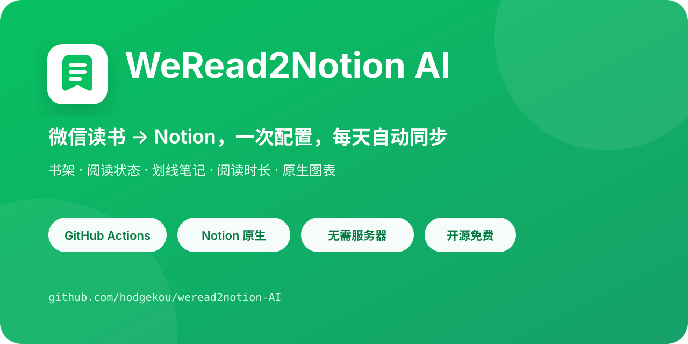
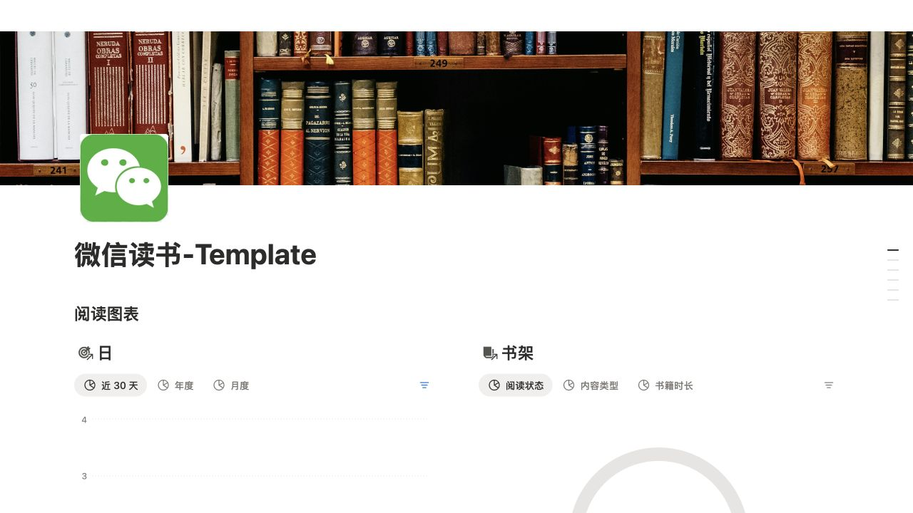

  

  

  
  
  
  

  <a href="https://app.notion.com/p/wph/Template-3a329affe5af800b8581f98b71e948fb">复制 Notion 模板</a> ·
  <a href="https://hodgekou.github.io/weread2notion-AI/guide.html">使用指南</a> ·
  <a href="https://github.com/hodgekou/weread2notion-AI/issues/new/choose">提交问题</a>

# WeRead2Notion AI

[简体中文](README.md) · [English](README.en.md) · [日本語](README.ja.md) · [项目官网](https://hodgekou.github.io/weread2notion-AI/)

一个免费开源的 **微信读书 → Notion 自动同步**工具。它会把你的书架、阅读状态、阅读时长、章节、划线、个人想法和阅读统计同步到 Notion 原生模板中，并由 GitHub Actions 每天自动运行。

  

关键词：微信读书、Notion、自动同步、划线、笔记、阅读统计、GitHub Actions。

## 可以同步什么

- 以微信读书 `/shelf/sync` 为权威来源同步当前书架。
- 同步书籍、作者、分类、日/周/月/年阅读统计和原生 Notion Charts。
- 将划线和个人想法按章节写入书籍页面正文，不创建大量 Tag。
- 以微信读书人工“读完”标记判断“已读”，不会用 100% 阅读进度代替完成状态。
- 每天为每本书保存一条阅读快照，记录累计时长、当日新增时长、进度、状态和当前章节。
- 支持普通增量同步、全量重建、dry-run 预览、GitHub Actions Summary 和本地数据导出。

## 配置步骤

整个过程不需要服务器，只用到 Notion 和 GitHub。每一步的详细操作、注意事项和排错方法见[完整使用指南](https://hodgekou.github.io/weread2notion-AI/guide.html)。

1. **复制模板**：打开 [WeRead2Notion AI Template](https://app.notion.com/p/wph/Template-3a329affe5af800b8581f98b71e948fb)，点击右上角 **Duplicate**，复制到自己的 Notion Workspace。
2. **创建 Integration 并连接页面**：在 [Notion Integrations](https://www.notion.so/profile/integrations) 新建 Integration，启用 `Read content`、`Insert content`、`Update content`；回到复制出的最外层页面，在 `••• → Connections` 中添加它。
3. **Fork 本仓库**，在自己的 Fork 中打开 `Settings → Secrets and variables → Actions`，添加下表三个 Repository secrets。
4. **手动运行一次**：打开 Fork 的 **Actions → weread sync → Run workflow**，首次不勾选 `full`。完成后在 job 的 **Summary** 查看同步数量，再刷新 Notion。
5. 之后每天 **北京时间 04:00** 自动同步，也可以随时手动运行。

| Secret | 内容 |
| --- | --- |
| `WEREAD_API_KEY` | 微信读书 Gateway API Key，可从 [微信读书助手](https://weread.qq.com/r/weread-skills) 获取 |
| `NOTION_TOKEN` | 第 2 步创建的 Notion Integration Secret |
| `NOTION_PAGE` | 第 1 步复制出的新页面完整 URL（不要填公共模板链接） |

不要把 Token、API Key、Cookie 或 `.env` 内容提交到 GitHub。

## 更多文档

- [使用指南](https://hodgekou.github.io/weread2notion-AI/guide.html)：完整配置步骤、同步规则、Notion 个性化设置、本地运行和常见问题。
- [技术参考](docs/TECHNICAL.md)：模板数据库、环境变量、CLI 命令和开发说明。
- [更新记录](CHANGELOG.md) · [v1.0.0 发布说明](docs/RELEASE_NOTES_v1.0.0.md)

## 问题反馈

请通过 [GitHub Issues](https://github.com/hodgekou/weread2notion-AI/issues/new/choose) 提交问题或功能建议，并附上复现步骤和脱敏后的日志。绝不要提交任何 API Key、Token、Cookie、`.env` 内容或私人笔记原文。

## AI 生成声明

本项目的代码、文档以及 Notion 模板适配工作完全由 OpenAI ChatGPT（Codex，GPT-5 系列模型）生成。

## License

[MIT](LICENSE)
